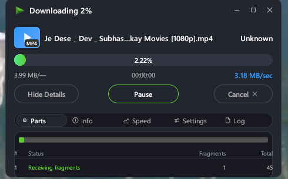
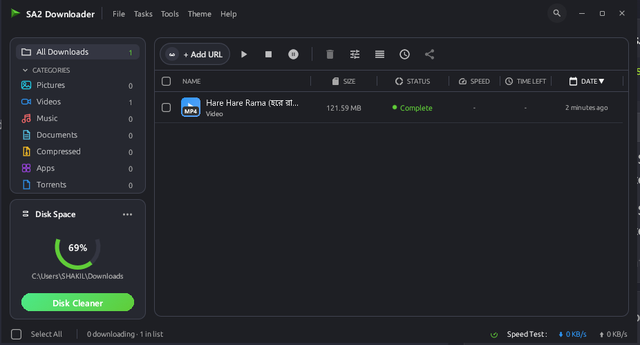
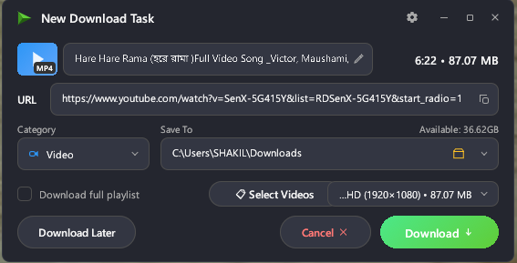
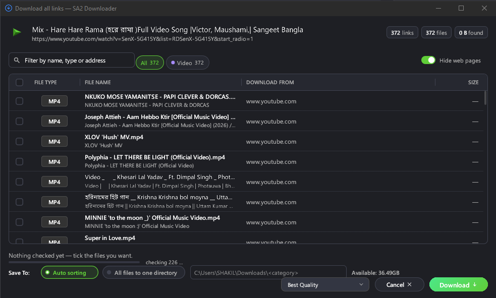
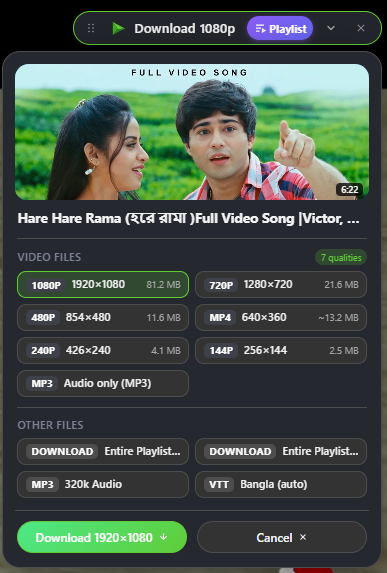
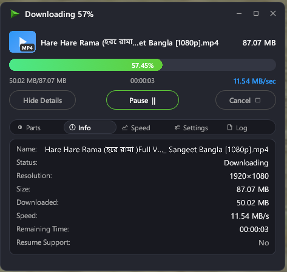
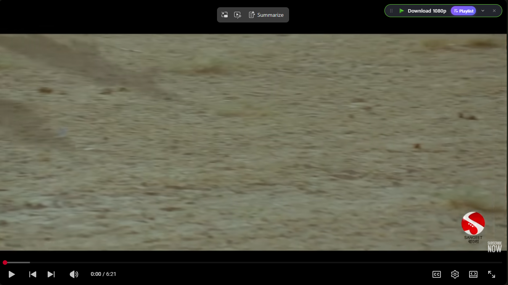
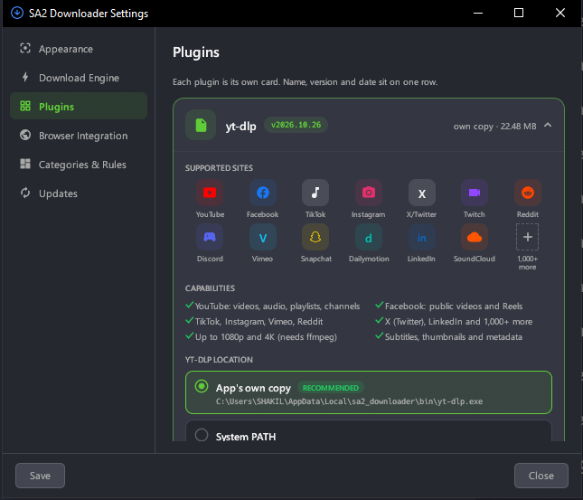
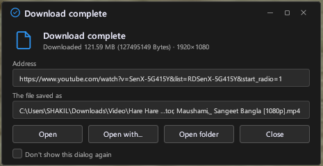

<div align="center">



# SA2 Downloader

**A fast, advanced IDM-grade download manager — engineered for ultra-fast multi-threaded acceleration and ultra-high-definition 2K, 4K, and 8K downloads.**

Multi-connection parallel downloads, dynamic segmentation work-stealing, YouTube up to 8K Ultra HD (4320p), Facebook, TikTok, Instagram, Vimeo, and 1,000+ sites through custom stream parsers and yt-dlp + FFmpeg merging. Comes with a futuristic glassmorphic browser extension that catches the streams other tools miss.

[](LICENSE)
[](https://www.rust-lang.org)
[](#-features)

<br>

[](https://github.com/hungry-detective/downloadcraft/releases/download/v0.9.10/DownloadCraft-0.9.10-windows-x64-portable.zip)
&nbsp;
[](https://github.com/hungry-detective/downloadcraft/releases/download/v0.9.10/DownloadCraft-0.9.10-macos-Universal.zip)
&nbsp;
[](https://github.com/hungry-detective/downloadcraft/releases/tag/v0.9.10)

[](https://github.com/hungry-detective/downloadcraft/releases/download/v0.9.10/DownloadCraft-Chrome-0.9.10.zip)
&nbsp;
[](https://github.com/hungry-detective/downloadcraft/releases/download/v0.9.10/DownloadCraft-Firefox-0.9.10.xpi)

<sub>Windows 10/11 · macOS 12+ (Apple Silicon & Intel) · Linux x86-64 (DEB, RPM, AppImage) · <a href="https://github.com/hungry-detective/downloadcraft/releases">all releases</a></sub>

<br><br>



</div>

---

## ✨ What's new in 0.9.10

- **Google Drive links** download the file itself (big files and Docs/Sheets/Slides exports too).
- **Archives unpack themselves**: ZIP, RAR (multi-part too) and 7z when they finish, or right-click → Extract.
- **A smarter video button**: Instagram, TikTok, X and Reddit posts, MP3 audio only, one click in the quality
  you picked last, right-click "Download video", and a neat round button on YouTube Shorts.
- **Browser downloads keep their sound**: joined videos are now normal, seekable MP4 files.
- **A tidier app**: redesigned Site Grabber, header icons, a toolbar that fits narrow windows, and
  double-click a running download to see its progress window.

Full notes: [Release 0.9.10](https://github.com/hungry-detective/downloadcraft/releases/tag/v0.9.10).

---

## 📸 Screenshots

<table>
  <tr>
    <td width="55%" valign="top">
      
      <p><b>Capture a link</b> — the app checks its real name and size before it starts.</p>
    </td>
    <td width="45%" valign="top">
      
      <p><b>Watch it fly</b> — live speed, time left and every parallel connection.</p>
    </td>
  </tr>
</table>

<p align="center">
  <br>
  <b>Download all links</b> — every file on a page with its type and size; check, filter, download.
</p>

<table>
  <tr>
    <td width="50%" valign="top">
      
      <p><b>Extension popup</b> — every video on the page, with the app or in the browser alone.</p>
    </td>
    <td width="50%" valign="top">
      
      <p><b>Downloads tab</b> — browser downloads and the app's queue, side by side.</p>
    </td>
  </tr>
</table>

<p align="center">
  <br>
  <b>On every player</b> — a small <i>Download this video</i> bar, see-through until you need it.
</p>

<table>
  <tr>
    <td width="58%" valign="top">
      
      <p><b>Settings</b> — yt-dlp, FFmpeg and the JavaScript runtime install and update themselves.</p>
    </td>
    <td width="42%" valign="top">
      
      <p><b>Done</b> — open the file, open it with another app, or show its folder.</p>
    </td>
  </tr>
</table>

---

## 🚀 Features

**Downloading & BitTorrent**
- **Dynamic segmentation** (1–32 connections): a free connection takes over half of whatever would finish
  last, so no connection idles while another crawls. Crash-safe resume, self-healing connections and
  automatic link refresh.
- **BitTorrent & Magnet Links:** Native support for `magnet:?xt=urn:btih:...` and `.torrent` files. High-speed DHT, peer exchange (PEX), seed tracking, and live connection telemetry without requiring an external torrent client.
- A global speed limit, per-download connections and a per-server connection cap.
- Queue with concurrency limit, scheduler, retry-all-failed and finish actions (shutdown / sleep / hibernate).
- Smart names from the server or the video title; safe auto-rename or overwrite; optional SHA-256 check.
- HLS and DASH streams (live recording, AES-128), video + audio merged with FFmpeg.

**Video sites, Playlists & Ultra HD (2K / 4K / 8K)**
- **Dynamic Max Resolution Auto-Detection:** Automatically probes and selects the absolute highest available resolution for any video (8K 4320p, 4K 2160p, 2K 1440p, 1080p FHD, 60fps AV1/VP9).
- **Full Playlist & Album Downloading:** One-click download for complete YouTube playlists, channel batches, albums, and series with auto-indexing (`01 - Title.mp4`) and unified quality selection.
- **Auto-Merged Audio & Video:** High-res video tracks automatically merge with best available audio codecs (Opus, AAC, M4A) via managed FFmpeg.
- **Universal Site Coverage:** YouTube, Facebook & Instagram Reels, TikTok, Vimeo, Bilibili, X (Twitter), Reddit, and over 1,000+ streaming sites detected on-the-fly.

**Browser extension (Chrome, Edge, Brave, Firefox)**
- Catches videos from network traffic, manifests, and page data — HLS, DASH, MP4/WebM, torrents, magnets, and playlists.
- Floating glassmorphism *Download this video* player bar with instant 8K/4K/2K resolution badges and a dedicated **Playlist** download button.
- Works **without the app**: downloads, joins and saves videos in the browser.
- **IDM-style hand-off.** A browser download is *paused*, handed to the app, and resumed in the browser if the app can't take it. Form (POST) downloads, browser request headers, proxy, and auth cookies all go along.

**Desktop App**
- IDM-style Categories sidebar: All, Pictures, Videos, Music, Documents, Compressed, Apps, **Torrents**, and **Playlists**.
- System / Dark / Light themes, status sidebar, search, sortable and resizable columns, speed graphs, and bulk actions.
- Clipboard detection for both direct links and magnet URIs.

---

## ⚡ The engine

The download engine is a separate, reusable Rust crate,
[`crates/downloadcraft-engine`](crates/downloadcraft-engine). Use it to make your own downloader fast
too (MIT).

- **Work stealing.** When a connection finishes, it splits the part that will finish last, in
  proportion to the measured speeds. A slow connection never holds the whole download back, and very
  slow ones are reopened.
- **The first request is the probe.** Downloading starts at once; more connections join as soon as the
  server shows it supports ranges.
- **One pre-allocated file.** There is no joining of parts at the end, so bytes are not copied a second
  time.
- **Crash-safe resume.** A journal of the missing ranges is flushed every few seconds. A changed server
  file (size, ETag, Last-Modified) is detected instead of being stitched onto old bytes.
- **Self-healing.** HTTP 429/503 lowers the connection count, a per-IP connection limit is detected,
  and cut or stalled connections resume where they stopped.
- **Expired links.** A refused signed link is retried through its original URL, or re-resolved from
  its page, keeping every byte already downloaded.
- **Checks every reply.** A wrong `Content-Range`, a different size, or an HTML error page instead of
  the file is caught before it can corrupt the download.
- **ZIP preview.** `download_craft peek <url>` lists what's inside a remote ZIP without downloading it.

Measured on a home connection (100 MB, 8 connections) against 0.9.8: speedtest.belwue.net went from
70.6 s to **21.4 s**, and mirror.nforce.com from 28.2 s to **19.7 s**.

```rust
let done = downloadcraft_engine::Downloader::new(reqwest::Client::new())
    .download(Job::new(url, "file.iso"), progress, control)
    .await?;
```

---

## 📦 Install

| Platform | Download | How |
|---|---|---|
| **Windows 10/11** | `DownloadCraft-0.9.10-windows-x64-portable.zip` | Extract and run `download_craft.exe` — nothing to install. |
| **macOS 12+** | `DownloadCraft-0.9.10-macos-Universal.zip` | Move *Download Craft.app* to Applications (development build, not notarized — right-click → Open the first time). |
| **Ubuntu / Debian / Mint** | `downloadcraft_0.9.10_amd64.deb` | `sudo apt install ./downloadcraft_0.9.10_amd64.deb` |
| **Fedora** | `downloadcraft-0.9.10-1.x86_64.rpm` | `sudo dnf install ./downloadcraft-0.9.10-1.x86_64.rpm` |
| **Other Linux** | `DownloadCraft-0.9.10-x86_64.AppImage` | Make it executable and open it. |

**Browser extension**
1. **Chrome / Edge / Brave:** extract `DownloadCraft-Chrome-0.9.10.zip`, open `chrome://extensions`, turn on
   *Developer mode*, choose **Load unpacked** and pick the `browser-extension` folder.
2. **Firefox:** open `about:debugging#/runtime/this-firefox` → **Load Temporary Add-on…** → pick
   `DownloadCraft-Firefox-0.9.10.xpi`.
3. In the app, open **Settings → Browser Integration** and press **Install** for your browser, so the
   extension can talk to the app. (Without it, the extension still downloads in the browser.)

Your queue and settings live in `%APPDATA%\download_craft` (Windows) and carry over between versions.

---

## 🛠️ Build from source

Prerequisites: [Rust stable](https://www.rust-lang.org/tools/install) (MSVC build tools on Windows).

```powershell
cargo build --release   # target\release\download_craft.exe (portable)
cargo test --workspace  # app + engine crate: unit and local HTTP tests (no network needed)
node --test browser-extension/*.test.js   # extension tests
```

Packaging: `python scripts/package.py --platform windows --arch x64` (see [PORTABLE-BUILDS.md](PORTABLE-BUILDS.md)
for macOS and Linux).

**Command line:** `download_craft.exe add "https://example.com/file.zip"`,
`download_craft.exe get "https://example.com/file.zip" -o out.zip`,
`download_craft.exe peek "https://example.com/file.zip"`, `download_craft.exe --help`.

---

## 📄 License

MIT — free for open-source, closed-source and commercial use. See [`LICENSE`](LICENSE);
[`NOTICE.md`](NOTICE.md) lists the bundled third-party assets (Material Icons, fonts).

<div align="center"><sub>Screenshots use Blender Foundation open movies (CC BY) and public test streams.</sub></div>
